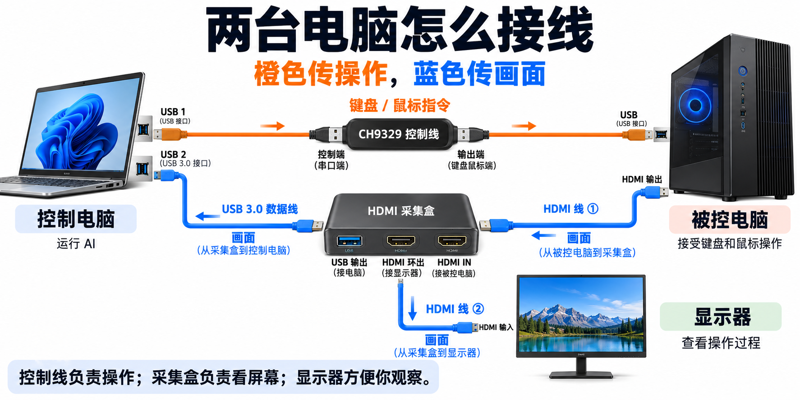

# 幽灵员工：让 AI 帮你操作另一台电脑

这个项目让 AI 能看到另一台电脑的屏幕，并像人一样敲键盘、移动鼠标、点击按钮。

你需要两台电脑：

- **控制电脑**：运行 AI，负责发出操作指令。原说明里的“上位机”就是它。
- **被控电脑**：接受 AI 操作的那台电脑。

连接后，AI 通过 HDMI 采集盒“看屏幕”，通过 CH9329 控制线“敲键盘、按鼠标”。你可以在显示器上看到操作过程。

## 1. 准备这些东西

| 东西 | 用来做什么 | 需要满足什么条件 |
| --- | --- | --- |
| 控制电脑 | 运行 AI 和控制脚本 | 能联网；安装 Python 3.11 或更新版本；能使用 Codex、OpenClaw 等可运行本地脚本的 AI 工具 |
| CH9329 键盘鼠标控制线 | 把控制电脑的指令变成键盘和鼠标输入 | 一端接控制电脑，另一端接被控电脑 |
| HDMI 采集盒 | 把被控电脑的画面传给控制电脑 | 有 HDMI 输入、USB 输出；按本文接法，还需要 HDMI 环出接口 |
| 被控电脑 | 接受 AI 操作 | 有 USB 接口，支持 USB 键盘和鼠标输入；能通过 HDMI 输出画面 |
| USB 3.0 连接线 | 连接采集盒和控制电脑 | 接头要与采集盒、电脑匹配，并且支持数据传输 |
| HDMI 线 2 根 | 传输画面 | 一根接采集盒，一根接显示器 |
| 显示器 | 让你看到被控电脑的画面 | 有 HDMI 输入接口 |

控制电脑需要至少两个可用的 USB 接口：一个接控制线，另一个接采集盒。接控制线的接口可以是 USB 2.0；接采集盒的接口按原方案使用 USB 3.0。如果电脑只有 Type-C 接口，需要配合支持数据传输的转接头。

## 2. 把线接好



分成两条线路接，就不容易混淆。

### 第一条：让 AI 能敲键盘、按鼠标

```text
控制电脑的 USB 接口
        ↓
CH9329 控制线的控制端（串口端）
        ↓
CH9329 控制线的输出端（键盘鼠标端）
        ↓
被控电脑的 USB 接口
```

原说明把控制端叫“小头”，输出端叫“大头”。实际连接时，优先看线材上的标识或说明，确认哪一端接控制电脑。

### 第二条：让 AI 和你都能看到屏幕

```text
被控电脑的 HDMI 输出
        ↓ HDMI 线
采集盒的 HDMI IN（输入）
        ├── USB 输出 → USB 3.0 连接线 → 控制电脑
        └── HDMI OUT / LOOP OUT（环出）→ HDMI 线 → 显示器
```

“环出”可以理解为：采集盒在把画面送给控制电脑的同时，再把画面传给显示器。

接好后，把两台电脑和显示器开机，并将显示器切换到对应的 HDMI 输入。显示器上应当能看到被控电脑的画面。

## 3. 在控制电脑上启动 AI

1. 将本项目文件放在控制电脑上。
2. 打开能访问这些文件、运行本地脚本的 AI 工具，例如 Codex 或 OpenClaw。
3. 确认 AI 已登录、网络正常，并让它在本项目目录中工作。
4. 新建对话，发送下面这段话，把方括号里的内容换成你的任务。

```text
请先阅读当前项目目录中的 `给AI看的.md`，按照其中的说明操作被控电脑。
任务：[写清楚你希望完成的事情]
```

例如，你可以这样写：

```text
请先阅读当前项目目录中的 `给AI看的.md`，按照其中的说明操作被控电脑。
任务：打开系统设置，查看当前的屏幕分辨率，并告诉我结果。
```

## 4. 你需要做什么

AI 操作的是**被控电脑**。你在**控制电脑**上和 AI 对话，在**显示器**上观察被控电脑的画面和操作过程。

任务描述尽量具体，写清楚要操作什么、希望得到什么结果。设备端口和采集设备编号可能变化，项目里的 `给AI看的.md` 会提示 AI 自己查找。

## 5. 接好后没反应，先检查这些

| 遇到的问题 | 先检查什么 |
| --- | --- |
| 显示器没有画面 | 被控电脑是否开机；HDMI 线是否接牢；采集盒输入、环出是否接对；显示器是否选对 HDMI 输入 |
| 显示器有画面，但 AI 看不到 | 采集盒的 USB 是否连接到控制电脑；USB 线是否支持数据传输；AI 是否找到了正确的采集设备编号 |
| AI 能看到画面，但无法点击或输入 | CH9329 控制线两端是否接对；被控电脑是否识别到 USB 输入设备；AI 是否找到了正确的串口 |
| AI 提示缺少 Python 库 | 本项目脚本使用 `pyserial` 和 `opencv-python`，可让 AI 在控制电脑的 Python 环境中安装 |
| AI 无法读取项目文件或运行脚本 | 是否使用了支持本地文件和命令执行的 AI 工具；是否已打开本项目目录 |

相关文件：

- [给AI看的.md](给AI看的.md)：AI 使用设备和脚本的操作说明。
- [给人看的.md](给人看的.md)：原始说明，保留不变。
